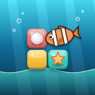
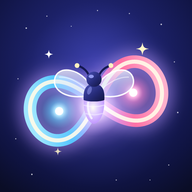

# Tinyhearth Studio

**Warm games for happy moments.**

Tinyhearth Studio is an independent game studio. We make warm, beautiful mobile games that are easy to pick up, kind to your time and a joy to come back to, for players all around the world.

---

## Our games

### Puffin Bakehouse
*Coming soon to Google Play*

Grandma Puffin left you the keys to a tiny bakery on a windy cliff. Bake fresh bread, serve a line of hungry animal customers and grow her little shop into the coziest bakery in town. Plays offline.

[Privacy policy](puffin-bakehouse-privacy.html) · Support: tinyhearthstudio.games@gmail.com

 

---

### Reefbloom
*Coming soon to Google Play*

Clear blocks to rescue sea creatures and grow a coral reef of your own. A calm block puzzle with a new goal every level and a Daily Tide puzzle. Plays offline.

[Privacy policy](reefbloom-privacy.html) · Support: tinyhearthstudio.games@gmail.com

 

---

### Glowloop
*Coming soon to Google Play*

Draw loops of light to catch fireflies under a starry sky. Mix colours to discover 120 firefly species, relight 10 night realms and grow your own Night Garden. Plays offline.

[Privacy policy](glowloop-privacy.html) · Support: tinyhearthstudio.games@gmail.com

 

---

### Nudgeville
*Coming soon to Google Play*

Watch the mishap, rewind time, then make one nudge and a chain reaction rescues an animal friend. A cute physics puzzle with 120 hand-checked levels and a daily puzzle. Plays offline.

[Privacy policy](nudgeville-privacy.html) · Support: tinyhearthstudio.games@gmail.com

 

---

### Gearwick
*Coming soon to Google Play*

Pull pins, open valves, flip levers and drop parts to fix the town's broken machines. A physics puzzle with 60 levels in 3 worlds, a daily puzzle and gentle hints. Plays offline.

[Privacy policy](gearwick-privacy.html) · Support: tinyhearthstudio.games@gmail.com

 

---

## What we care about

- **Cozy first.** Relaxing play and calm progress, at your own pace.
- **No accounts.** Our games don't ask you to sign in, and your progress stays on your phone.
- **Fair ads.** Our games are free and supported by ads. Rewarded videos are always optional.
- **Made for everyone.** Gentle, family-friendly content.

---

## Contact

For business or general questions: **tinyhearthstudio.games@gmail.com**

For help with a specific game, write to the same address and tell us which game it is.

<small>© 2026 Tinyhearth Studio</small>
